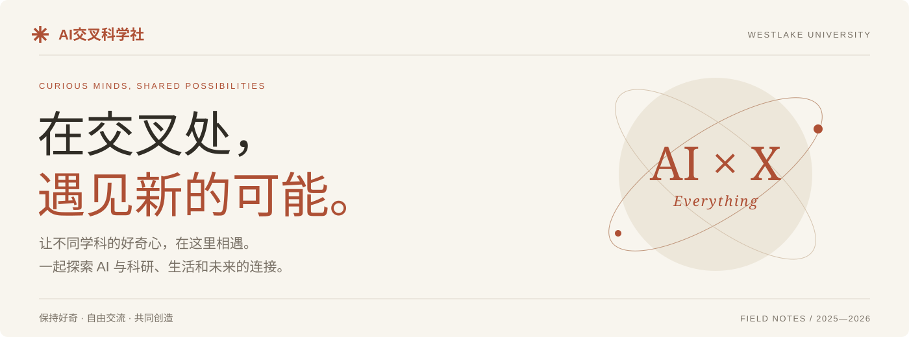
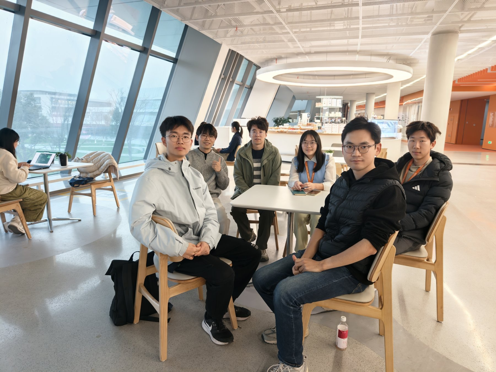
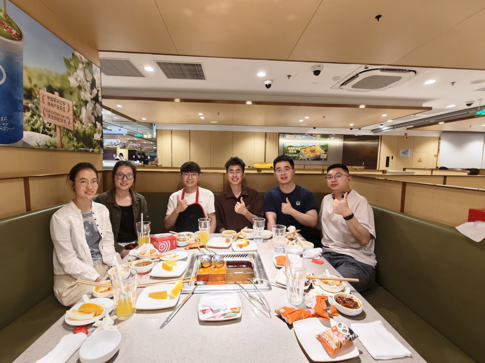
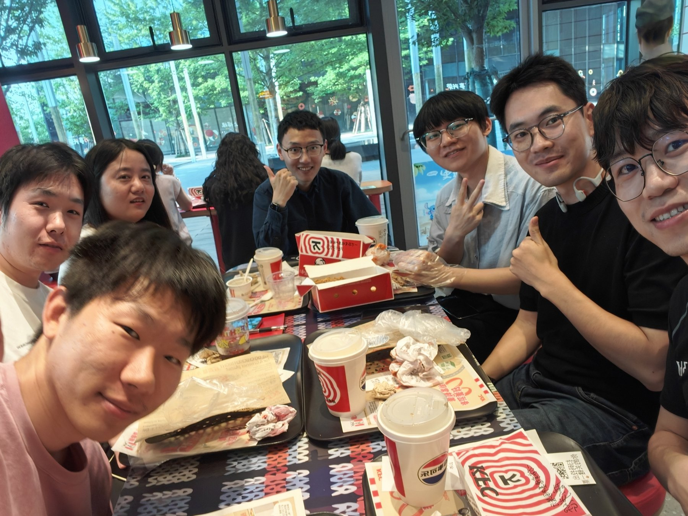
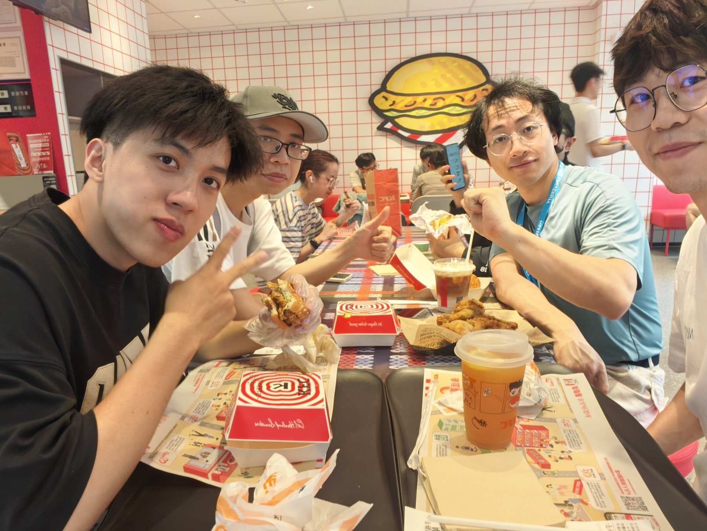
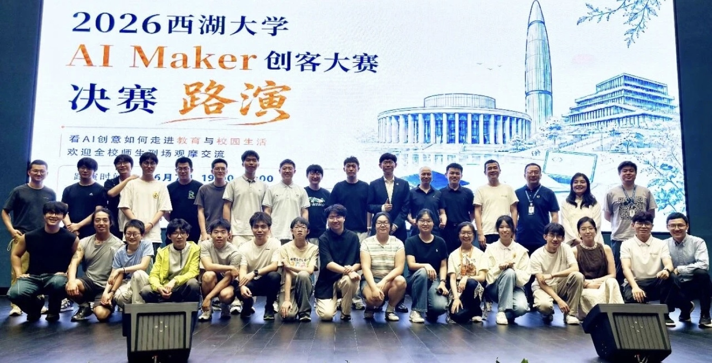
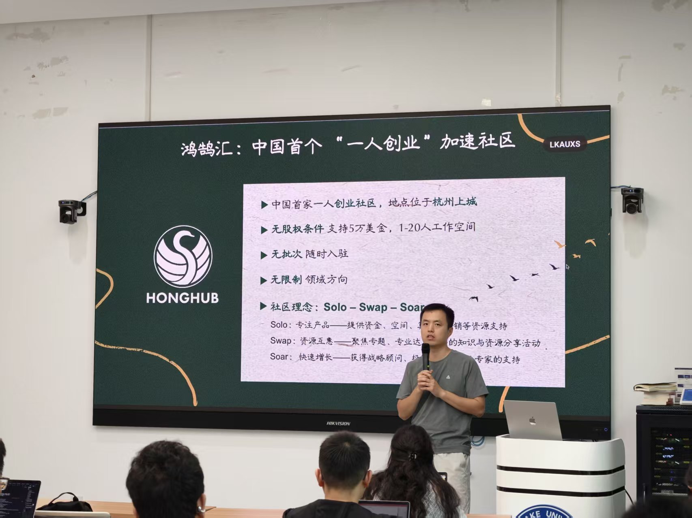
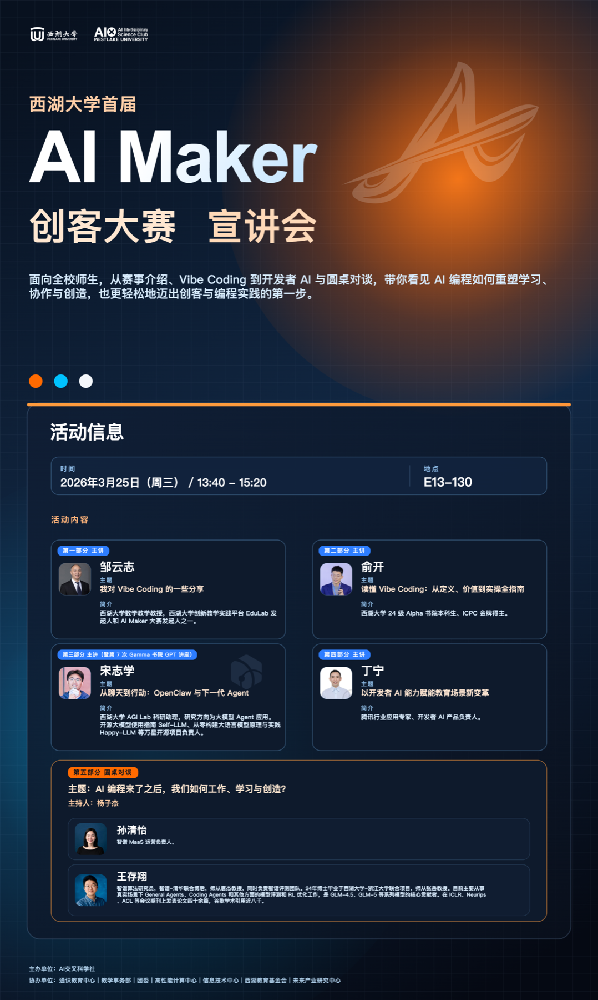
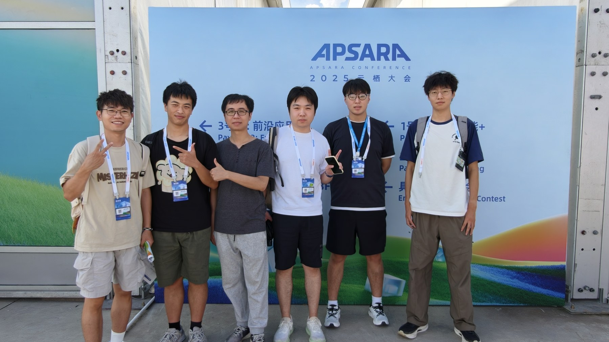
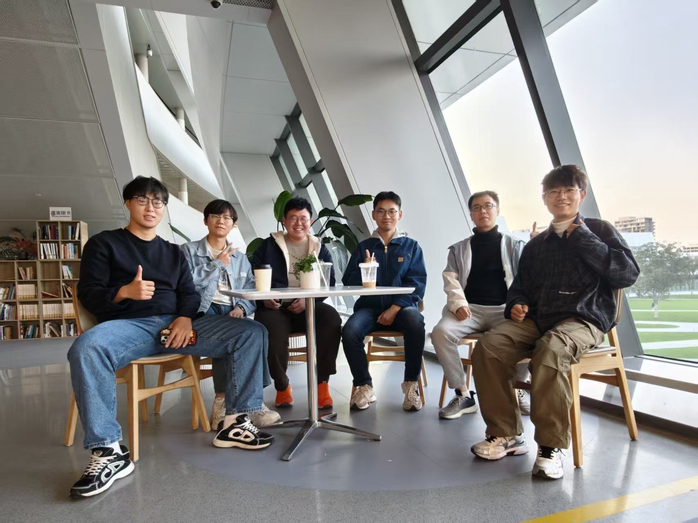

<a name="top"></a>

<p align="center">
  
</p>

<p align="center">
  <a href="#about">我们是谁</a> &nbsp; · &nbsp;
  <a href="#weekly">每周相聚</a> &nbsp; · &nbsp;
  <a href="#events">特别活动</a> &nbsp; · &nbsp;
  <a href="#local">运行网站</a>
</p>

<p align="center"><b>不止于 AI，更关乎我们如何理解世界。</b><br><sub>23 场日常交流记录 &nbsp; / &nbsp; 4 项特别活动 &nbsp; / &nbsp; 2025—2026 我们的共同记忆</sub></p>

---

<a name="about"></a>

### 让不同背景的同学，坐到同一张桌前。

<table>
<tr>
<td width="48%" valign="top">

<p align="center"><b>一张桌子，无限种想法。</b><br><sub>THE PEOPLE BEHIND THE IDEAS</sub></p>
</td>
<td width="52%" valign="top">
<p><sub>ABOUT AIISC / 我们是谁</sub></p>
<p>AI交叉科学社是<b>西湖大学的跨学科学生社团</b>。我们围绕人工智能前沿、AI 与科研、教育、工具实践，以及人机关系与社会影响，持续开展专题讨论与交流。</p>
<p>你可以带着技术问题来，也可以带着对 AI 时代的困惑来。在这里，分享工具经验和提出哲学问题，同样值得被认真倾听。</p>
<p><b>探索</b> · 以好奇为起点<br><b>连接</b> · 让交流有温度<br><b>创造</b> · 从想法走向实践</p>
</td>
</tr>
</table>

<a name="weekly"></a>

## 每周相聚，灵感生长。

<sub>01 / EVERYDAY CONNECTIONS</sub>

咖啡馆、饭桌与教室里，记录我们关于 AI 的每一次好奇。

<table>
<tr>
<td width="33%" valign="top">

<p><sub>2026.06.04 / WEEKLY GATHERING</sub></p>
<h3>AI 独居应用</h3>
<p>从智能音箱到安全、健康与情感支持，聊聊 AI 如何走进一个人的生活。</p>
</td>
<td width="33%" valign="top">

<p><sub>2026.05.28 / WEEKLY GATHERING</sub></p>
<h3>AI 意识</h3>
<p>从推理与生成出发，追问意识、认知与学习，探索 AI 能如何帮助我们理解生物智能。</p>
</td>
<td width="33%" valign="top">

<p><sub>2026.05.21 / WEEKLY GATHERING</sub></p>
<h3>AI 最新进展</h3>
<p>关注本周 AI 热点，让不同研究背景的观察与问题，在一次轻松的交流中相遇。</p>
</td>
</tr>
</table>

<details>
<summary><b>回看全部 23 场日常交流记录 →</b></summary>

| 日期 | 我们聊过的话题 |
| --- | --- |
| 2026.06.04 | AI独居应用 |
| 2026.05.28 | AI意识 |
| 2026.05.21 | AI最新进展 |
| 2026.05.12 | 通过吃饭解放科研生产力 |
| 2026.04.23 | AI工具发展 |
| 2026.04.16 | 人类AI关系 |
| 2026.04.10 | AI数字分身 |
| 2026.03.27 | AI本质 |
| 2026.03.20 | openclaw |
| 2026.01.29 | AI技术问题 |
| 2026.01.22 | AI文本特征 |
| 2026.01.15 | AI4S科学革命 · 新范式陷阱 |
| 2026.01.08 | AI中心化 |
| 2025.12.26 | VibeCoding |
| 2025.12.18 | 回顾年度AI进展 |
| 2025.12.12 | 核心竞争力 |
| 2025.12.04 | AI深度思考 |
| 2025.11.27 | AI教育 |
| 2025.11.21 | AI替代 |
| 2025.11.12 | AI前沿与隐患 |
| 2025.11.06 | AI最新发展 |
| 2025.10.29 | 地锅鸡小群 |
| 2025.10.23 | AI科研 |

</details>

<a name="events"></a>

## 把讨论带向更大的现场。

<sub>02 / BEYOND THE EVERYDAY</sub>

连接校园与产业，连接想法与实践。与同行者一起，打开更多可能。



### 首届西湖大学 AI Maker 创客大赛

<sub>2026.06.07 / 教育 × 校园生活 × Vibe Coding</sub>

从一个真实问题，做出自己的工具。面向全校师生，鼓励 1–3 人团队运用 AI 与 Vibe Coding，把校园中的真实需求转化为可演示、可体验的网页应用。**9 支队伍进入决赛路演**，通过现场演示与评委问答呈现创意和实践成果。

[阅读西湖大学官微报道《导师太忙，我帮导师弄了个面试系统》 ↗](https://mp.weixin.qq.com/s/7bjmroyW2qhr1HmRLBKnUg)

<table>
<tr>
<td width="33%" valign="top">

<p><sub>2026.06.17</sub></p>
<h3>AI 创业实践与跨学科创新</h3>
<p>AI交叉科学社 × Honghub 鸿鹄汇。三位创业者走进校园，把机器人、AI 硬件与内容创作的真实经验带到讨论现场。</p>
</td>
<td width="33%" valign="top">

<p><sub>2026.03.25</sub></p>
<h3>AI Maker 赛前宣讲会</h3>
<p>从 Vibe Coding、OpenClaw 与下一代 Agent，到 AI 在教育中的应用，一起讨论技术如何改变工作、学习与创造。</p>
</td>
<td width="33%" valign="top">

<p><sub>2025.09.26</sub></p>
<h3>走进 2025 云栖大会</h3>
<p>走进“云智一体，碳硅共生”的科技现场，在论坛、展览与互动体验中，连接产业与开发者生态。</p>
</td>
</tr>
</table>

---

<p align="center"><sub>CURIOUS MINDS, SHARED POSSIBILITIES</sub></p>
<h2 align="center">带着问题来，<br>带着新的视角离开。</h2>
<p align="center">从一场轻松的讨论，到一次大胆的创造。<br>让好奇心，持续发生。</p>

<p align="center"></p>

<a name="local"></a>

<details>
<summary><b>运行完整社团网站 · 局域网分享与 A4 二维码海报</b></summary>

下载本仓库后，在 macOS 上双击 **`启动社团网页.command`**。浏览器会自动打开二维码页面；连接同一 Wi-Fi 的手机可以扫码访问。分享期间保持终端窗口开启，结束时按 **Control + C**。

也可以在项目目录运行：

```bash
python3 serve_local.py
```

网站优先使用 `8765` 端口，遇到占用时自动寻找下一个可用端口。二维码页面还提供 A4 海报与 PDF 下载。

[查看完整启动说明、端口设置和常见问题 →](docs/readme/local-guide.md)

</details>

<p align="center"><sub>AI交叉科学社 · 西湖大学 &nbsp; / &nbsp; 一起探索，一起创造</sub><br><a href="#top">回到顶部 ↑</a></p>
